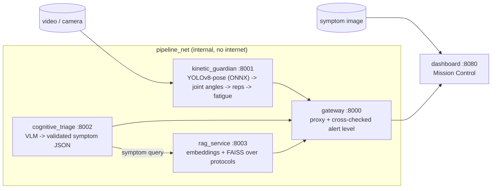

# C.O.S.M.I.C. AEGIS

**Cottbus Orbital Software for Medical Informatics & Care - Aerospace Edge-Guardian for Informatics & Security**

An offline, containerised, dual-pipeline edge-AI prototype that monitors astronaut health and suggests
cited treatment procedures when Earth is too far away to help (up to a 40-minute radio round trip to Mars).

> **Prototype for decision support only. It is not a medical device and does not diagnose.**
> Built for the NASA Space Apps Challenge 2026.

## Architecture



Design principles:

- **Separation of concerns.** Spatial tracking (pipeline 1) and medical reasoning (pipeline 2) are different
  models in different containers with no shared memory. If the kinetic pipeline crashes, triage keeps running.
- **Config-driven.** Every service reads its own `config.json` (mounted read-only).
- **Offline.** ML services sit on an `internal` Docker network with no internet access; model weights and the
  embedding model are cached locally beforehand.
- **Citation-only answers.** The RAG service returns excerpts from the protocol corpus with source and page.
  It does not generate free text, so it cannot invent medical advice. Irrelevant queries return "no protocol
  found, escalate".
- **Distrust model output.** VLM output is parsed and validated; malformed JSON, unknown conditions or low
  confidence become "no finding".
- **Sensor-glitch defence.** A form alert needs 5 consecutive bad frames.
- **Alert agreement.** `critical` only when both pipelines flag; one flag is `warning`.
- **Hardened containers.** Read-only filesystems, all Linux capabilities dropped, `no-new-privileges`, memory
  limits, healthchecks; ports published on localhost only.

### Services

| Dir | Port | Role | Key endpoints |
|---|---|---|---|
| `kinetic_guardian/` | 8001 | Pose estimation, rep counting, fatigue/form score | `/status`, `/frame.jpg`, `/reset` |
| `cognitive_triage/` | 8002 | Image -> symptom JSON -> RAG plan | `/triage`, `/info` |
| `rag_service/` | 8003 | Ingest + search protocol documents | `/ingest`, `/query`, `/stats` |
| `gateway/` | 8000 | Single entry point, alert level | `/services`, `/overview`, `/triage`, `/kinetic/*` |
| `dashboard/` | 8080 | Static Mission Control UI | - |

Shared code is in `shared/common.py`. One-time setup scripts are in `scripts/`.

## Run instructions

### Prerequisites
- Docker with Compose v2 (optional: NVIDIA Container Toolkit for GPU)
- Python 3.10-3.12 on a dev machine with internet, for the one-time downloads below

### 1. Get the pose model (online, once)
```bash
pip install ultralytics
python scripts/export_pose_model.py
```
Creates `models/yolo_pose.onnx`. For TensorRT on an NVIDIA GPU:
```bash
trtexec --onnx=models/yolo_pose.onnx --saveEngine=models/yolo_pose.engine --fp16
```

### 2. Cache the embedding model (online, once)
```bash
pip install sentence-transformers
python scripts/download_embedder.py
```

### 3. Add inputs
- An exercise video at `data/video/sample_ared.mp4` (or set a camera index as `video_source` in
  `kinetic_guardian/config.json`).
- Real, public NASA/CSA protocol documents (PDF, txt or md) in `rag_service/data/protocols/`.
  The bundled `SAMPLE_placeholder.md` is **not** a real protocol; replace it.

### 4. Start
```bash
docker compose up --build
```
Open http://localhost:8080 (dashboard). API: http://localhost:8000/services

### 5. Build the protocol index (once, and after changing documents)
```bash
docker compose exec rag_service curl -X POST http://localhost:8003/ingest
```

### 6. Try it
- Dashboard: watch the skeleton feed, reps and fatigue; upload an image in **Cognitive Triage**.
- Resilience demo:
  ```bash
  docker compose stop kinetic_guardian
  ```
  The dashboard shows it as `down`; triage and RAG keep working. Restore with
  `docker compose start kinetic_guardian`.

### Using a real VLM
By default `cognitive_triage` uses a **mock** backend that returns a fixed laceration finding, so the full
pipeline can be demoed without a GPU. **Label mock output as simulated.** To use a real model:
1. Download Qwen2-VL-2B-Instruct into `models/vlm`.
2. Set `"backend": "transformers"` in `cognitive_triage/config.json`.
3. Add `torch transformers accelerate` to `cognitive_triage/requirements.txt` and uncomment the GPU
   `deploy` lines in `docker-compose.yml`.

This backend is written but has not been run yet.

### Tests
Unit tests need no Docker, model or GPU:
```bash
pip install pytest numpy fastapi httpx
cd kinetic_guardian && python -m pytest -q    # angles, reps, fatigue, debounce
cd ../rag_service && python -m pytest -q      # chunking, search, refusal
cd ../cognitive_triage && python -m pytest -q # VLM output validation
cd ../gateway && python -m pytest -q          # alert levels, failure isolation
```

## Configuration

| File | Notable settings |
|---|---|
| `kinetic_guardian/config.json` | model path/providers, video source, fatigue window, debounce frames |
| `cognitive_triage/config.json` | VLM backend/path, allowed conditions, `min_confidence`, disclaimer |
| `rag_service/config.json` | corpus dir, chunk size/overlap, `top_k`, embedding model |
| `gateway/config.json` | upstream URLs, alert cooldown |

## Status and limitations

Implemented and unit-tested: pose-metric maths, rep/fatigue logic, alert debounce, RAG chunk/search/refusal,
VLM output validation, gateway alert levels.

**Not yet run or verified:** Docker build of the whole stack, ONNX pose inference on real video, the real
embedding model, the Qwen2-VL backend, TensorRT performance.

Known limits: fatigue scoring is a heuristic, not a clinical measure; a small VLM is not clinically
validated and its confidence is uncalibrated; no space-realistic medical imagery was used; the sleep and
heart-rate (infrared) monitor is not implemented; the dashboard assumes the gateway at `localhost:8000`;
`/ingest` rebuilds the whole index.

## Submission
See `submission/`: `DEMO.md` (video script, slide outline, draft form answers), `AEGIS_slides.pptx`
(built by `build_slides.js`) and `CHECKLIST.md`.

## AI-assistance disclosure
Much of this code and documentation was generated with AI assistance (Claude). Mock VLM output is
simulated. No NASA logos or branding are used.
