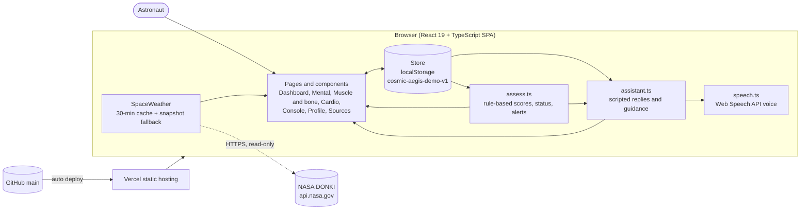
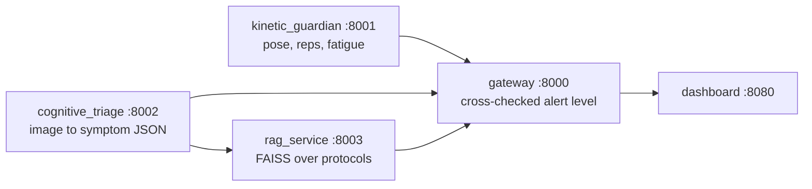

# C.O.S.M.I.C. AEGIS

**Understand Your Health Beyond Earth.**

Built by **Team AEGIS** (Hira Qaiser, Srikant Kavitha Parasuraman, Kishore Kumar Mani Kandan) for the NASA Space Apps Challenge 2026:
[Create Health Monitoring Software for Astronauts on Space Missions](https://www.spaceappschallenge.org/2026/challenges/health-monitoring-software/).

**Live site:** https://cosmic-aegis-beryl.vercel.app

> **Prototype for demonstration only. Not a medical device.** It does not diagnose, predict or prevent any condition.
> Health entries are sample data and every threshold is illustrative. Not affiliated with or endorsed by NASA or the
> Canadian Space Agency. Code, text and artwork were created with AI assistance (Claude by Anthropic).

---

## The idea

### The problem
On long missions the crew is far from home. Round-trip radio delay to Mars can reach about 40 minutes, so real-time
medical help is not available. NASA's Human Research Program identifies five hazards of human spaceflight:
radiation, isolation and confinement, distance from Earth, gravity fields, and hostile or closed environments.
Their health effects build up slowly (poor sleep, rising stress, muscle and bone loss, cardiovascular change), which makes them easy to miss day to day.

### Our solution
AEGIS is one calm place where an astronaut logs how they feel and what they did. It turns those entries into
trends, plain-language explanations and gentle alerts across three health areas:

| Area | What AEGIS tracks | Example alert (illustrative rules) |
| --- | --- | --- |
| Mental health | Mood, stress, fatigue, sleep | 3+ of the last 5 check-ins report high stress, or average sleep below 6.5 h |
| Muscle and bone | Exercise type, minutes, strength | Fewer than 4 active days in 7, or falling strength trend |
| Cardiovascular | Heart rate, blood pressure, SpO2 | Latest values outside illustrative ranges, 7-day changes |

An assistant reads the user's **own entries**, explains them, and speaks **step-by-step guidance aloud**. The aim is
early awareness and clear information for the crew medical officer, not diagnosis. Because the Earth link is slow, the
design also includes delay-tolerant messaging and SOS rehearsal.

### Why it matters
- Helps crews notice slow changes early and feel less alone.
- Supports autonomy when ground contact is delayed.
- Needs no special hardware; runs in any modern browser.
- Honest by design: every value is labelled simulated or live, and the site says what it cannot do.

---

## Features

The site opens on the **Dashboard**, which begins with a 30-second animated, narrated story.

- **Dashboard:** story, profile, mission status, overall 0-100 score (Nominal / Watch / Review), alerts, 14-day trends, simulated live ticker.
- **Live NASA space weather:** real events from **NASA DONKI** (geomagnetic storms, solar energetic particle events, radiation belt enhancements, CMEs) turned into a QUIET / WATCH / ELEVATED radiation-awareness label.
- **NASA HRP mapping:** the five hazards, each linked to the AEGIS feature that responds to it.
- **Mental, Muscle and bone, Cardio pages:** forms with validation, trend charts, gentle suggestions.
- **Habitat console (`/console`):** ten modules, including the astronaut companion (4-7-8 breathing pacer, reaction test), a mock ground-control view with simulated signal delay, a delay-tolerant message queue, module checklist and hex byte viewer.
- **SOS practice:** 10-second countdown with siren tone. Practice only; nothing is sent.
- **AEGIS assistant:** floating chat plus voice guidance (Web Speech API). Scripted and rule-based, not an AI model. Crisis or emergency wording is redirected to real help.
- **Profile and Sources:** optional history, NASA/CSA references, real-versus-simulated table.

Screenshots are in [`web/shots/`](web/shots).

---

## Architecture

AEGIS is a **frontend-only single-page app**. There is no server and no account. Data stays in the browser, and the
only network call is the read-only NASA DONKI request.



### Data flow
1. The user submits a form (check-in, exercise, vitals). Input is validated and saved by the **store** to `localStorage`.
2. **`assess.ts`** reads the entries and computes scores, status levels and alerts with simple, documented rules.
3. Pages render trends (Recharts), alerts and the overall score from those results.
4. **`assistant.ts`** uses the same results to answer questions and to build the personalised spoken plan; **`speech.ts`** reads it aloud.
5. **`SpaceWeather`** makes one request to NASA DONKI per visit (cached 30 minutes). If it fails, a labelled snapshot of real events is shown.

### Design principles
- **Honest labelling.** Simulated and live data are clearly distinguished everywhere.
- **Safety first.** No diagnosis or prediction; emergency wording is redirected to real help.
- **Privacy.** No accounts, tracking or backend; data never leaves the device.
- **Accessibility.** Always-on story captions, optional narration, reduced-motion support, keyboard-friendly controls, text as well as colour for status.
- **Graceful degradation.** The app works offline apart from the live NASA panel.
- **Replaceable parts.** The scripted assistant and simulated inputs are isolated so a language model or real sensors can replace them.

### Project structure
```
web/
  src/
    pages/         Dashboard, Mental, Musculoskeletal, Cardiovascular, Console, Companion, Profile, Sources
    components/    Layout (HUD header, ticker), Assistant, Story, SpaceWeather, Starfield, charts, forms, ui
    lib/           store, assess (rules), assistant (scripted), speech, seed (sample data), chartData, team
    integrations/  typed FUTURE INTEGRATION stubs (computer vision, ML analysis, wearables)
  public/          logo and favicon
  shots/           screenshots and QR code
  vercel.json      route rewrite for the SPA
```
Earlier Python edge-AI backend services remain in the repository root; see the last section.

### Tech
React 19, TypeScript, Vite 8, React Router 7, Tailwind CSS 4, Recharts, lucide-react. Web Speech API (voice), Web Audio (tones), Canvas (starfield), `localStorage`. Hosted on Vercel from GitHub.

---

## Real versus simulated

| Part | Status |
| --- | --- |
| Forms with validation, charts, rule-based alerts, local saving | Implemented |
| Voice guidance, scripted assistant, 30-second story, SOS practice, delay-tolerant queue | Implemented (simulated scenario) |
| **Space-weather events from NASA DONKI (api.nasa.gov)** | **Live NASA data** |
| Astronaut, mission, history, vitals, cabin readings, bone status, ticker | Simulated demo data |
| Computer-vision exercise analysis, ML health analysis, wearables, language-model assistant | Future integration |
| Clinical validation, flight-surgeon workflows | Future work with medical teams |

## NASA resources

- NASA DONKI Space Weather Database via NASA Open APIs (live): https://api.nasa.gov/
- 5 Hazards of Human Spaceflight (NASA HRP): https://www.nasa.gov/hrp/hazards/
- Risks of Human Spaceflight (NASA HRP): https://www.nasa.gov/hrp/risks/
- Ongoing HRP Research in Space: https://www.nasa.gov/hrp/ongoing-hrp-research/
- HRP evidence reports (NTRS): https://ntrs.nasa.gov/api/citations/20170004604/downloads/20170004604.pdf and https://ntrs.nasa.gov/api/citations/20150016006/downloads/20150016006.pdf

## Run it locally

Requires Node 20+.

```bash
cd web
npm install
npm run dev        # http://localhost:5173
npm run build      # type-check + production build into dist/
npm run preview    # serve the production build
```

Optional: set `VITE_NASA_API_KEY` to your free key from https://api.nasa.gov. Without it the site uses NASA's shared
`DEMO_KEY`, which is rate limited (the panel then shows a labelled snapshot). The footer's **Reset demo data** button restores sample data.

## Deploy

Vercel: Root Directory `web`, Framework Vite, Build `npm run build`, Output `dist`. Pushes to `main` deploy automatically.

## Roadmap

1. Real wearable and habitat sensor feeds in place of simulated values.
2. Computer-vision exercise form analysis (stubs in `web/src/integrations/`).
3. A safe language-model assistant with citations, under medical oversight.
4. Clinical validation of thresholds with flight surgeons.
5. Encrypted sync for crew and ground teams with proper privacy review.

## Known limitations

- Demo data and illustrative rules only; no clinical validity.
- Data lives in one browser; clearing site data removes it.
- Speech voices depend on the browser and device.
- Tested in desktop and phone widths in a Chromium-based browser; other browsers are untested.

---

## Earlier backend prototype (separate)

Before the website we built an offline, containerised, dual-pipeline edge-AI prototype (Docker Compose): pose-based
exercise fatigue tracking (`kinetic_guardian`), image-to-symptom triage (`cognitive_triage`), a citation-only retrieval
service over NASA protocol documents (`rag_service`), a `gateway` that cross-checks alerts, and a static `dashboard`.
It is not connected to the website. See the service folders and `docker-compose.yml` for details.


